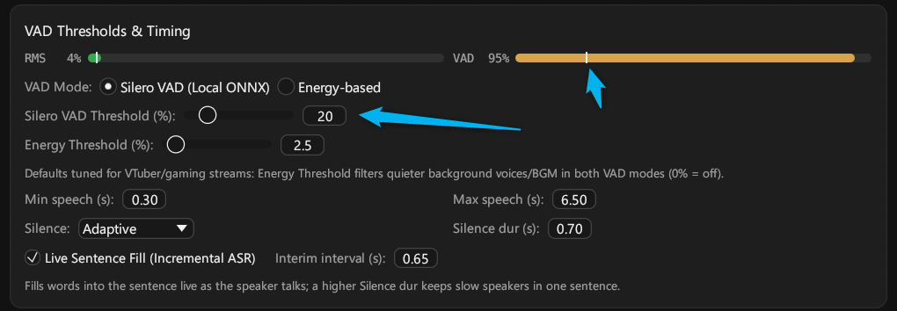

# Translate Live

A fast, local, private Windows live stream & VOD audio translator built in Rust (`eframe`/`egui` + statically linked `sherpa-onnx` non-Whisper ASR + Silero VAD + embedded `llama.cpp` with Vulkan GPU acceleration and automatic CPU fallback).

Capture live Windows system audio (WASAPI loopback + optional mic), transcribe Japanese/Korean/Chinese/multilingual speech without Whisper outro hallucinations, and translate in real time with rolling conversational context onto a movable, resizable, transparent subtitle overlay.

---

## Download & Quick Start (Windows 10 / 11 x64)

### 1. Download `Translate-Live.exe`
- **Direct Download:** [**Download `Translate-Live.exe` (~71 MB)**](https://github.com/revisionhiep-create/Translate-Live/raw/main/Translate-Live.exe)
  - Or click **`Translate-Live.exe`** in the repository file list above and choose **Download raw file**.
- Place `Translate-Live.exe` inside its own folder (for example `C:\Translate-Live\Translate-Live.exe`). No installer, Python, Conda, Ollama, or external DLL runtime is needed.
- **Windows SmartScreen note:** Because the open-source binary is unsigned, Windows Defender SmartScreen may show a prompt on first launch — click **More info** → **Run anyway**.

### 2. Download Models (First Run)
No AI models are bundled on startup:
1. Launch `Translate-Live.exe`.
2. Under **Shared Model Storage Folder**, keep `<exe_dir>\models` (created automatically on first download) or click **Browse...** to choose another drive/folder.
3. Choose a **Voice Capture (ASR)** preset matching the stream language (default: **Haas JA v1.0 (Quantized)**, or **Parakeet TDT-CTC 0.6B (JA)**, **Paraformer / FireRedASR2** for Chinese, **Zipformer Korean**, **Parakeet TDT v2/v3** for English/EU, **SenseVoice Small** multilingual, etc.) and click **Download Model**.
4. Under **Translation (LLM)**, keep the default **Qwen3.5-9B Uncensored Q4_K_M** (~5.24 GB), pick a dedicated translator (**HY-MT1.5-7B**, **Shisa v2.1 Qwen3-8B**, **TranslateGemma 12B**), or choose a lighter low-VRAM/CPU option (**Qwen3.5-4B Uncensored**, **HY-MT1.5-1.8B Q8_0**) and click **Download Model**.

### 3. Translate Any Live Stream or VOD
1. Check **Audio & VAD**: leave **WASAPI Loopback** on `System Default` to capture your default Windows playback output, or pick a specific channel if you use a virtual mixer (for example, BEACN Mix Create, Voicemeeter, or SteelSeries Sonar may route your browser to `Browser (BEACN Mix Create)` or your active speaker output). Pick the **Source** (`ja`, `ko`, `zh`, `yue`, `en`, or `auto`) and **Target** (`en` default) language.
2. Drag the transparent **Subtitle Overlay** into position and drag any edge/corner to resize it (window positions save per-monitor automatically).
3. Toggle **Live Capture** (or press **`F8`**) — translations will stream live at the bottom and smoothly scroll up (`3` recent lines visible by default).
4. Press **`F10`** to toggle **Click-Through** mode so clicks pass straight through the subtitle window to your video or game; press **`F9`** anytime to show/hide the overlay.

### 4. Tuning Voice Detection (Silero VAD & RMS Thresholds)



Watch the live **RMS** (green, left) and **VAD** (gold, right) meters while the speaker is talking in **Audio & VAD** → **VAD Thresholds & Timing**:

- Each meter has a **white vertical tick mark** showing its active threshold: speech triggers translation only when the live bars cross **past (to the right of)** those white markers.
- **Speaker is too soft or misses words (`VAD` stays below/left of the white line):** Lower **`Silero VAD Threshold (%)`** until the speaker's normal voice reliably pushes the gold **VAD** bar past the white line.
- **Background music or game SFX triggers false lines:** Raise **`Silero VAD Threshold (%)`** so only clear foreground speech crosses the white line.
- **Very quiet stream volume (`RMS` stays below its white line):** The green **RMS** bar must also cross the **`Energy Threshold (%)`** tick (`1.5%` default) to filter quiet BGM and faint background voices — lower **`Energy Threshold (%)`** (or set `0.0` to disable it) if your stream volume is turned low, or use the quick **General / YouTube** and **Gaming / BGM Stream** preset buttons in **VAD Thresholds & Timing**.

### System Requirements
- **OS:** Windows 10 or Windows 11 (64-bit)
- **GPU (Recommended):** DirectX/Vulkan-capable GPU with ~8 GB VRAM recommended for the default 9B Q4_K_M translator (~4 GB VRAM with Qwen3.5-4B, or ~2 GB / CPU with HY-MT1.5-1.8B; falls back automatically to CPU if Vulkan is unavailable).

---

## Key Features

- **Single Self-Contained Windows Executable (`Translate-Live.exe`)**:
  - No Python, Conda, Ollama, or external DLL runtime installation required.
  - No models are bundled or downloaded on startup; models download only when you click **Download Model** (saved by default into `<exe_dir>\models` and configurable via **Browse...**).
- **Zero-Hallucination Local ASR Presets (`sherpa-onnx`)**:
  1. `Haas JA v1.0 (Quantized)` — `oboroge0/Haas-ja-v1.0-onnx-quantized` *(Default)*
  2. `Parakeet TDT-CTC 0.6B (JA)` — `csukuangfj/sherpa-onnx-nemo-parakeet-tdt_ctc-0.6b-ja-35000-int8`
  3. `ReazonSpeech k2 v2 (Zipformer JA)` — `reazon-research/reazonspeech-k2-v2`
  4. `Paraformer Large (ZH / EN)` — `csukuangfj/sherpa-onnx-paraformer-zh-2024-03-09`
  5. `FireRedASR2 CTC (ZH / EN)` — `csukuangfj2/sherpa-onnx-fire-red-asr2-ctc-zh_en-int8-2026-02-25`
  6. `Zipformer Korean (KO)` — `k2-fsa/sherpa-onnx-zipformer-korean-2024-06-24`
  7. `Parakeet TDT 0.6B v2 (EN)` — `csukuangfj/sherpa-onnx-nemo-parakeet-tdt-0.6b-v2-int8`
  8. `Parakeet TDT 0.6B v3 (EN + 25 EU)` — `csukuangfj/sherpa-onnx-nemo-parakeet-tdt-0.6b-v3-int8`
  9. `SenseVoice Small (JA / KO / ZH / YUE / EN)` — `csukuangfj/sherpa-onnx-sense-voice-zh-en-ja-ko-yue-2024-07-17`
  - Plus a **Custom Hugging Face Link...** option in both ASR and LLM selectors supporting custom HF repos, `/resolve/`, `/blob/`, and `.tar.bz2` archive URLs.
- **VTuber & Live Stream VAD + 3-Line Smooth Scroll-Up Subtitles**:
  - Pre-tuned out of the box for VTuber streams (`Silero 20%` threshold, `1.5%` foreground Energy Threshold gate active in both VAD modes, `Adaptive` silence `0.85 s`, `0.25 s–8.0 s` speech window, `0.65 s` live fill cadence, `5` rolling context pairs, CJK clause-continuation stitching), plus one-click **General / YouTube** and **Gaming / BGM Stream** profile buttons.
  - Displays the **Translation** line on the overlay by default (the **Original** transcription line can be enabled anytime in **Overlay** settings).
- **Local GPU LLM Translation (`llama.cpp` Vulkan)**:
  - Curated GGUF Presets:
    1. `Qwen3.5-9B Uncensored Q4_K_M` — `HauhauCS/Qwen3.5-9B-Uncensored-HauhauCS-Aggressive` *(Default)*
    2. `HY-MT1.5-7B Q4_K_M` — `tencent/HY-MT1.5-7B-GGUF`
    3. `Shisa v2.1 Qwen3-8B Q4_K_M (JA ↔ EN)` — `mradermacher/shisa-v2.1-qwen3-8b-GGUF`
    4. `TranslateGemma 12B Q4_K_M` — `mradermacher/translategemma-12b-it-GGUF`
    5. `Qwen3.5-4B Uncensored Q4_K_M (Fast)` — `HauhauCS/Qwen3.5-4B-Uncensored-HauhauCS-Aggressive`
    6. `HY-MT1.5-1.8B Q8_0 (Ultra-Fast / CPU)` — `tencent/HY-MT1.5-1.8B-GGUF`
  - Uses model-native prompt formatting and multi-turn rolling conversation context (`5` pairs default), `LocalAgreement` forced-prefix locking during live fill (solid confirmed words + softer dimmed live tail) plus unconstrained full-context final re-translation on utterance completion, zero-flicker **Clean Sentences Only** mode, **3-Line Smooth Scroll-Up** crawl, `0.75 s` min read time, and DRY/repetition penalties.
- **Native Transparent Direct2D/DirectWrite Subtitle Overlay**:
  - Movable and edge-resizable over streams, games, and video players.
  - Real-time opacity (`0%–100%`), background color, corner radius, optional background image, click-through mode, top-most toggle, auto-hide fade timer, and customizable multi-line typography/outline/alignment.
- **Multi-Monitor Persistence & Off-Screen Safeguards**:
  - Independently saves `x`, `y`, `width`, `height`, and `maximized` state for both the Control Panel and Subtitle Overlay in `%APPDATA%\Translate-Live\settings.json` (400 ms debounced + exit save).
  - Supports negative virtual desktop coordinates and automatically recovers windows onto an active monitor (or bottom-center primary for the Subtitle Overlay) if a saved monitor is disconnected or `< 80x40 px` is visible.

---

## Default Global Hotkeys

- `F8` — Start / Stop Live Capture
- `F9` — Show / Hide Subtitle Overlay
- `F10` — Toggle Click-Through Mode

All hotkeys can be rebound, reset, or cleared live inside **Control & Models**.

---

## Building from Source (Windows x64)

### Prerequisites

- **OS**: Windows 10 or Windows 11 (x64)
- **Rust Toolchain**: `stable-x86_64-pc-windows-msvc`
- **Visual Studio 2022 Build Tools**: `Desktop development with C++` (MSVC, Windows SDK, CMake, Ninja)
- **LLVM**: `C:\Program Files\LLVM\bin` (`libclang.dll` for `llama-cpp-2` bindgen)
- **LunarG Vulkan SDK**: e.g. `1.4.363.0` (`glslc.exe`, headers, `vulkan-1.lib`)

### Build & Test

Run the bundled PowerShell build script (which sets up the VS 2022 x64 environment, Ninja, Vulkan SDK, short `CARGO_TARGET_DIR`, and `/MD` static `sherpa-onnx` libraries):

```powershell
.\build.ps1
```

This runs `cargo test`, builds the release binary, and outputs `Translate-Live.exe` in the project root.

### CLI Self-Test

```powershell
.\Translate-Live.exe --self-test --smoke
```

---

## License

This project is licensed under the [MIT License](LICENSE).
